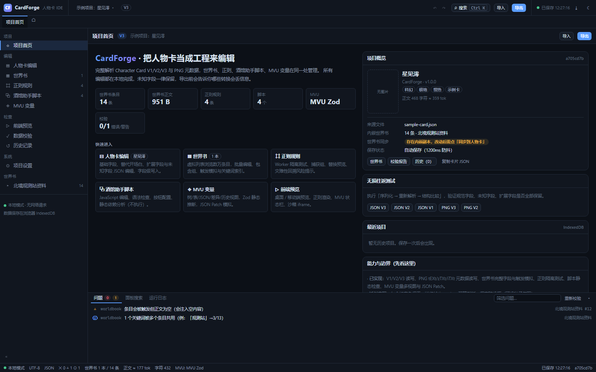
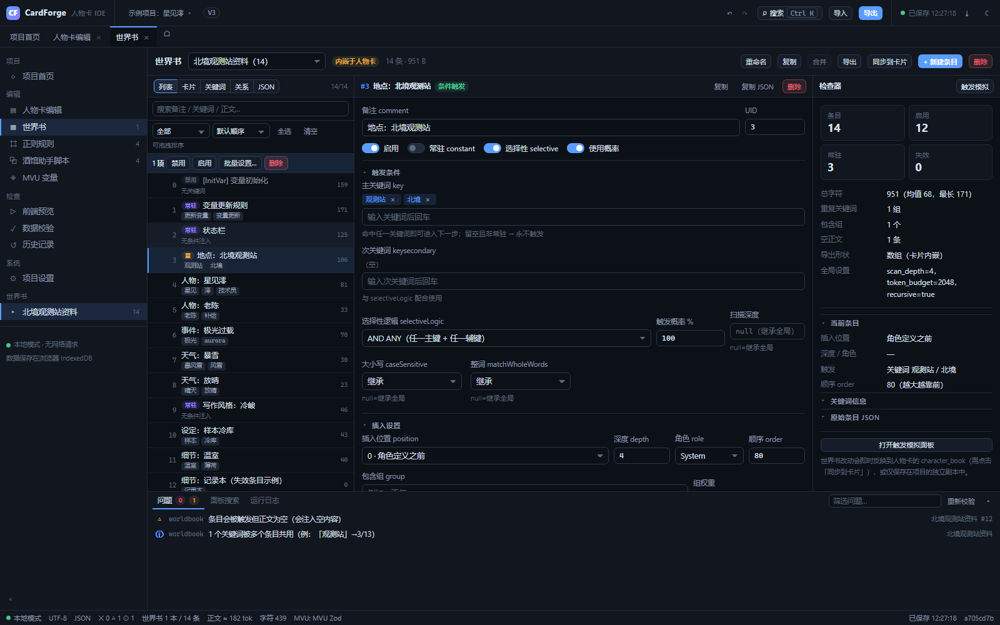
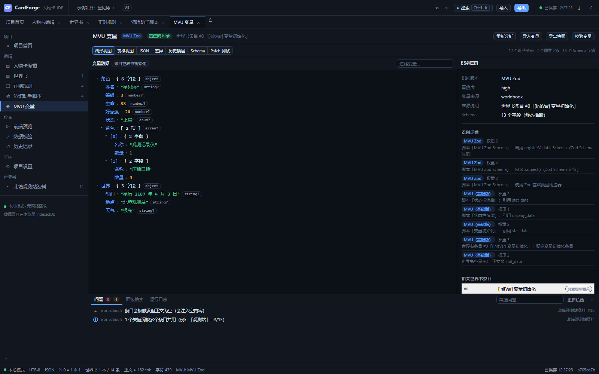
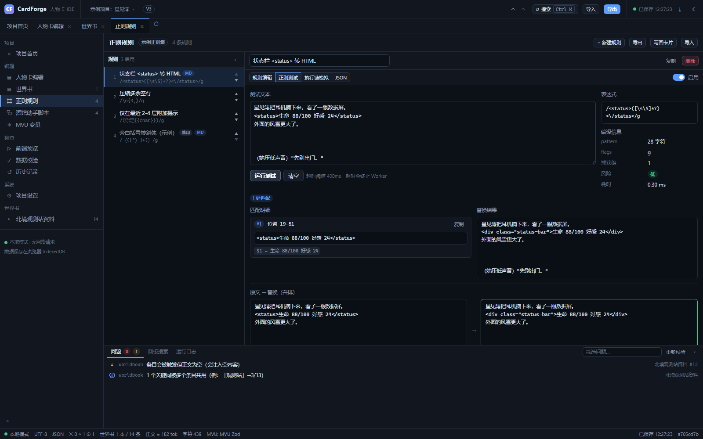
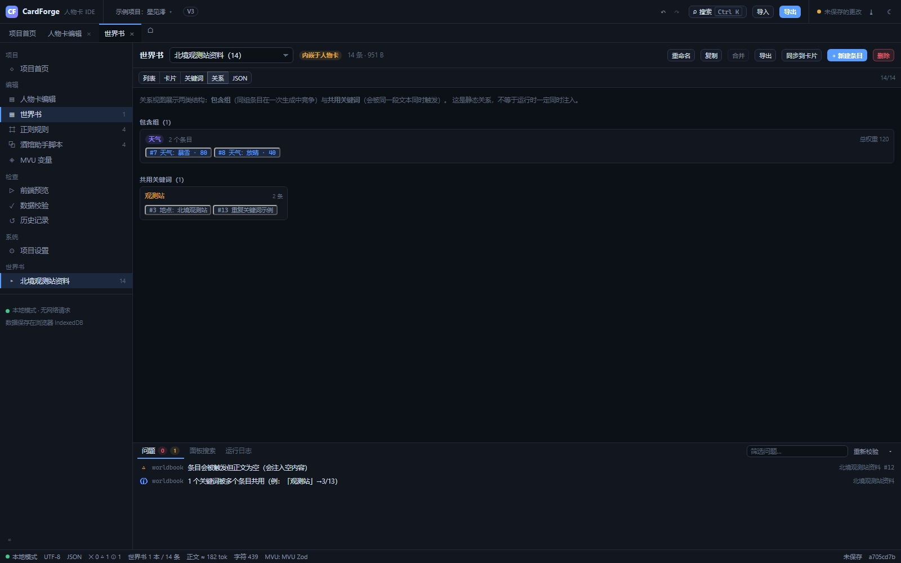

# CardForge · 酒馆人物卡 IDE

面向 SillyTavern 人物卡作者、世界书作者与 MVU 开发者的**本地优先**编辑器。
不是 JSON 文本框，而是把人物卡当作工程来管理：人物卡 / 世界书 / 正则 / 酒馆助手脚本 / MVU 变量 / 前端预览，都在一个 IDE 里完成。

> 纯前端、无服务器、无网络请求。数据保存在浏览器 IndexedDB。

[](LICENSE)
[](https://nodejs.org/)




---

## 快速开始

### 一键启动（推荐）

| 系统 | 操作 |
| --- | --- |
| Windows | 双击项目根目录的 **`启动.bat`** |
| macOS / Linux | 终端执行 `./start.sh`（首次可 `chmod +x start.sh`） |
| 任意系统 | `npm start` |

脚本会自动完成：检查 Node 版本 → 首次运行安装依赖 → 启动服务 → 等待端口就绪 → 打开浏览器。**只需要装好 Node.js 18+，其它都不用管。**

```
启动.bat            开发模式（热更新，改代码即时生效）
启动.bat --prod     生产模式（先构建再预览，不含开发工具）
启动.bat --no-open  只启动，不自动开浏览器
```

### 手动启动

```bash
npm install
npm run dev          # http://localhost:5178
```

生产构建与本地预览：

```bash
npm run build
npm run preview      # http://localhost:5179
```

首次打开会自动载入内置示例项目（含 14 条内嵌世界书、4 条正则、4 个脚本、MVU Zod Schema 与 3 个楼层变量），可直接体验全部功能。

---

## 功能一览

| 模块 | 能力 |
| --- | --- |
| **人物卡** | V1/V2/V3 读写；29 个规范字段表单；未知字段 JSON 编辑；Markdown 预览；字段级写入保证扩展字段不丢；与导入快照对比 |
| **世界书** | record/array/bare 三种形状；完整条目字段；虚拟列表（5 万条可用）；搜索（Worker）；筛选/排序/多选/批量；拖拽排序；右键菜单；关键词索引与关系视图；包含组；UID 冲突修复；合并/复制/同步到卡片；触发模拟（规则分级标注） |
| **正则** | `findRegex` 解析与 flags；捕获组说明；placement 1–6；深度窗口；trimStrings；隔离测试（400ms 超时）；执行链模拟；灾难性回溯检测；写回 `extensions.regex` |
| **酒馆助手脚本** | CodeMirror 编辑；语法检查（只编译不执行）；import/API/事件静态分析；按钮配置；`data`/`export_with`；只读模式 |
| **MVU** | mvu/mvubeta/mvuzod 识别（带证据与置信度）；`[InitVar]` YAML/JSON 解析；Zod 静态推断；树/表/JSON/差异/历史/Schema 视图；JSON Patch 与 `_.set` 模拟；多楼层变量 |
| **预览** | 桌面/移动/窄屏/自定义；正则渲染；MVU 状态栏；HTML 沙箱 iframe；导出预览 HTML |
| **导入导出** | JSON/PNG 人物卡、世界书、正则、脚本、MVU 快照；PNG tEXt/zTXt/iTXt 元数据读写；导出前检查；无损往返测试 |
| **工程能力** | 撤销/重做（immer 补丁）、多标签页、全局搜索、深/浅主题、自动保存、历史快照、校验面板、运行日志 |

---

### 界面预览

| 世界书（列表 + 编辑 + 检查器） | MVU 变量树 |
| --- | --- |
|  |  |

| 正则测试 | 关系视图 |
| --- | --- |
|  |  |

## 技术栈

TypeScript · React 18 · Vite · Zustand · immer（补丁历史）· CodeMirror 6 · 自研虚拟列表 · 自研 PNG 读写 · Web Worker × 2

---

## 目录结构

```
src/
├─ core/                 纯逻辑（无 DOM 依赖，可在 Node 中测试）
│  ├─ types.ts           统一数据模型
│  ├─ card.ts            人物卡识别 / 归一化 / 序列化 / 字段元数据
│  ├─ worldbook.ts       世界书解析 / 导出 / 冲突检测 / 合并 / 统计
│  ├─ regex.ts           findRegex 解析 / 执行 / 风险检测 / 执行链
│  ├─ scripts.ts         脚本归一化 / 语法检查 / 静态分析
│  ├─ yaml.ts            YAML 子集解析（MVU 初始化变量）
│  ├─ mvu.ts             MVU 识别 / 初始化条目 / Zod 静态解析 / 校验
│  ├─ patch.ts           RFC6902 + `_.set` 解析
│  ├─ png.ts             PNG 块读写（tEXt/zTXt/iTXt, CRC32）
│  ├─ simulate.ts        世界书触发模拟
│  ├─ validate.ts        校验引擎
│  ├─ importer.ts        JSON/PNG 类型嗅探与导入
│  ├─ exporter.ts        导出与导出前检查
│  ├─ roundtrip.ts       无损往返验证
│  ├─ format.ts          Markdown 渲染 / JS 基础格式化
│  ├─ stats.ts           项目统计
│  ├─ runtime.ts         Worker 客户端封装
│  ├─ idb.ts             IndexedDB 键值层
│  ├─ util.ts            指针 / base64 / 防抖 / 剪贴板辅助
│  └─ sample.ts          内置示例项目
├─ workers/
│  ├─ regex.worker.ts    正则执行（超时保护）
│  └─ search.worker.ts   世界书索引与查询（增量更新）
├─ store/store.ts        文档状态 / 历史 / 持久化 / 所有编辑动作
├─ ui/
│  ├─ App.tsx  Shell.tsx  modals.tsx  common.tsx
│  ├─ components/        CodeArea / VirtualList / JsonTree / DiffView / Modal / Field
│  └─ pages/             Home / Character / Worldbook / Regex / Scripts / Mvu / Preview / Validation / History / Settings
└─ styles.css            IDE 主题（CSS 变量，深/浅）

docs/                    技术实现计划书 / 数据结构 / 兼容性 / MVU 适配 / 使用说明 / 测试报告
scripts/                 selftest（51 项自测）· gen-testdata（生成 1k/10k/50k 世界书）
testdata/                测试数据
```

---

## 测试与验证

```bash
npx tsc --noEmit                 # 类型检查
npx tsx scripts/selftest.mjs     # 51 项核心自测 → docs/test-report-generated.md
npm run gen:testdata             # 生成测试数据

# 浏览器流程测试（需先 npm i -D playwright && npx playwright install chromium）
npm run dev
node scripts/ui-check.mjs            # 26 步，0 报错
node scripts/perf-check.mjs          # 1 万 / 5 万条目性能
```

实测（Chromium，1600×1000）：

| 指标 | 1 万条 | 5 万条 |
| --- | --- | --- |
| 导入到列表 | 361 ms | 1,084 ms |
| 虚拟列表 DOM 行数 | 34 | 34 |
| 搜索（Worker） | ~30–70 ms | ~70 ms |
| 序列化 | 28 ms / 5.9 MB | 177 ms / 35.5 MB |
| 手动保存 | — | 491 ms / 30 MB |

详见 [docs/测试报告.md](docs/测试报告.md)。

---

## 安全与边界

**做**：本地运行、未知字段保留、编辑可撤销、导出前检查、正则超时终止、HTML 沙箱、PNG 元数据字节级保留。

**不做**：执行导入的 JavaScript；上传任何内容；模拟向量化召回；解包 CHARX（会提示取出 `card.json`）；MVU 运行时求值。

**近似**：包含组权重、递归轮次、token 预算截断、概率随机源。UI 中逐条标注「精确 / 近似 / 未实现」。

---

## 文档

- [技术实现计划书](docs/技术实现计划书.md) —— 调查结论、选型、架构、数据模型、性能与测试方案
- [数据结构说明](docs/数据结构说明.md) —— 字段表、不变量、无损机制
- [兼容性说明](docs/兼容性说明.md) —— V1/V2/V3、PNG 块、世界书、正则、脚本、CHARX
- [MVU 版本适配](docs/MVU版本适配.md) —— 识别信号、对照表、Zod 解析范围、待验证项
- [使用说明](docs/使用说明.md) —— 每个页面怎么用、工作流、快捷键、FAQ
- [测试报告](docs/测试报告.md) —— 自测、浏览器流程、性能、无损、已知限制

---

## 许可与素材

**本项目禁止商用。** 采用 [PolyForm Noncommercial License 1.0.0](LICENSE)：

- ✅ 允许：个人学习、研究、实验、兴趣项目、自用创作；慈善机构、教育机构、公共研究机构、公立医疗/安全机构、环保组织、政府机构使用。
- ❌ 禁止：任何商业目的的使用，包括但不限于付费分发、SaaS 收费、集成进商业产品、承接商业项目时作为工具使用、企业内部经营性使用。
- 二次分发（含修改版）必须附带同一许可证与 `Required Notice` 版权行。
- 商业授权需单独联系作者（GitHub: [@yierlingyi](https://github.com/yierlingyi)）取得书面许可。

示例卡「星见澪」为原创示例内容，仅用于功能演示；应用不含任何第三方美术素材，PNG 导出的占位图由 Canvas 现场绘制。
